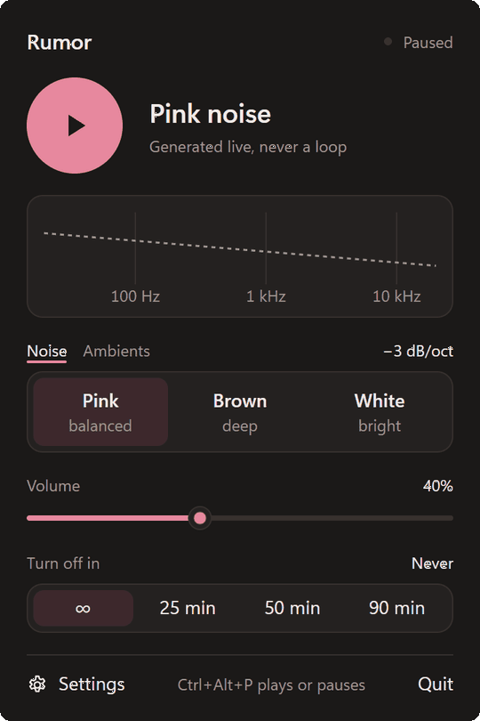
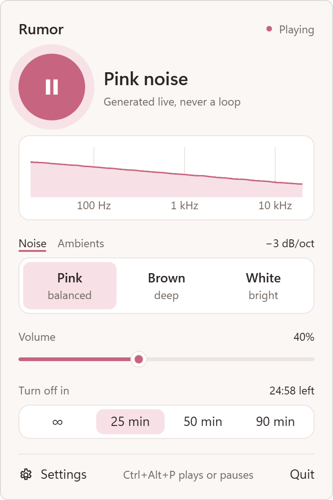
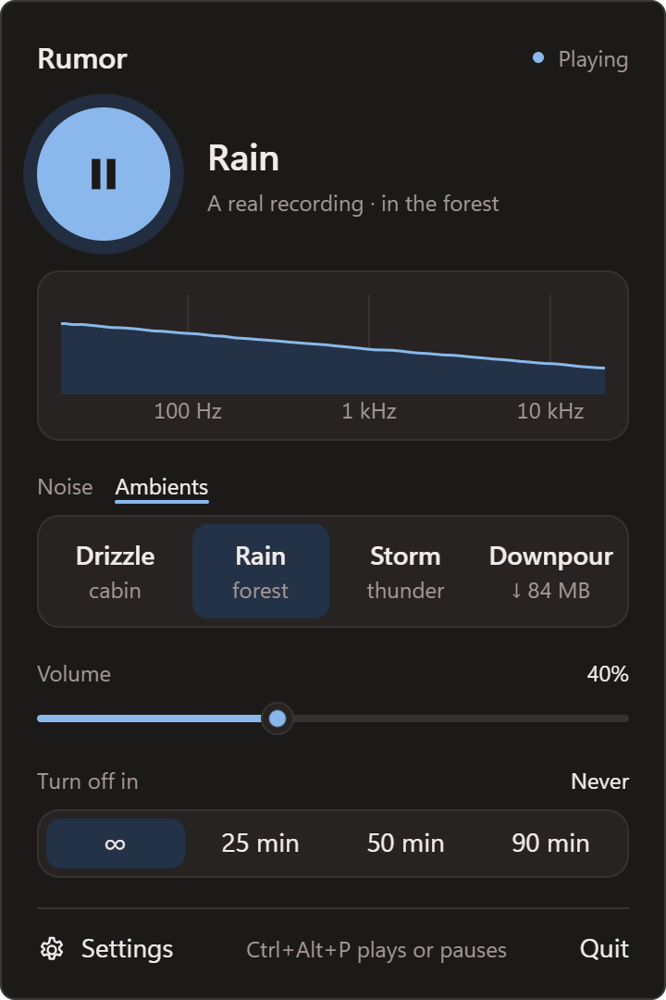
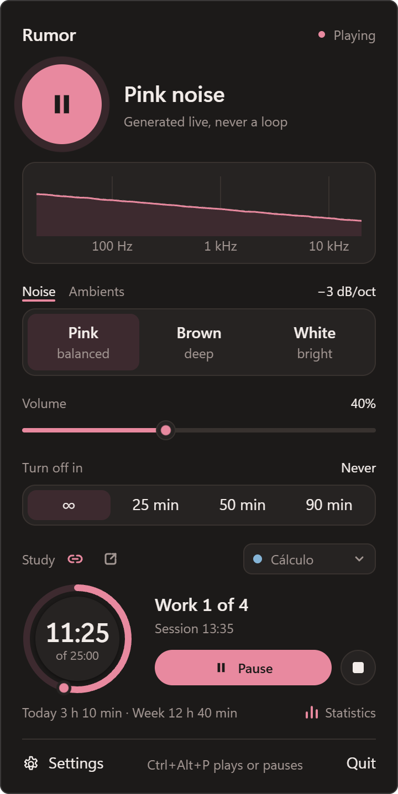
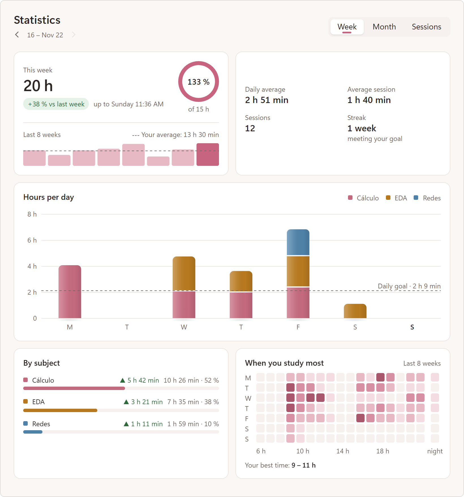
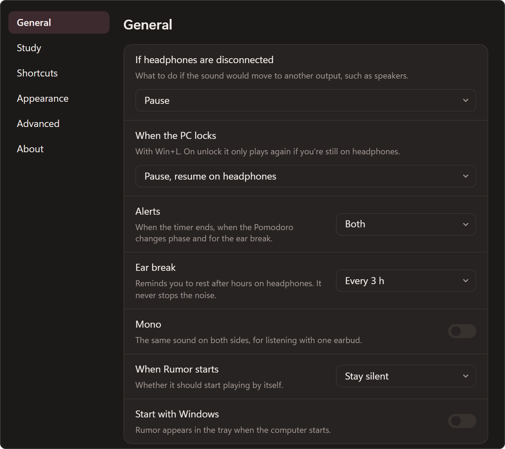

<p align="center">
  
</p>

<h1 align="center">Rumor</h1>

<p align="center"><b>Pink, brown and white noise, generated live in your Windows tray.</b><br>
Real rain recordings that never loop. An optional study timer. No account, no ads, no telemetry.</p>

<p align="center">
  <a href="https://github.com/YusteMa/rumor/releases"></a>
  
  <a href="LICENSE"></a>
</p>

<p align="center">
  
</p>

<p align="center">
  <a href="https://github.com/YusteMa/rumor/releases"><b>Download for Windows</b></a> · <a href="https://marioyuste.com/proyectos/rumor/"><b>Try it in your browser</b></a>
</p>

## Why

The pink noise on YouTube or Spotify is compressed audio. Noise is pure randomness, so a codec can't compress it without damage (it ends up sounding bubbly or metallic), and it's usually a loop your brain eventually learns to hear.

Rumor **computes the noise sample by sample** on your PC, the way the iPhone's Background Sounds do. It never repeats and nothing gets thrown away. It lives in the tray, one click or one shortcut away.

## Features

### Sound
- **Three colours**: pink (balanced), brown (deep) and white (bright), level-matched so switching never jumps in volume.
- **Ambients**: real rain recordings (drizzle, rain, storm and downpour) in lossless FLAC. Rumor plays random stretches joined with long crossfades, so **you never hear the loop**. Each one downloads the first time you pick it (30–80 MB).
- **No clicks, ever**: every play, pause and change fades in and out.
- **Live spectrum** of what's playing, plus mono mode for one earbud and a remembered volume per output.

### Headphones-aware
- **If your headphones disconnect, Rumor pauses** instead of blasting through the speakers. Wired and Bluetooth.
- **It also pauses when you lock the PC** (Win+L) and resumes on unlock only if you're still on headphones.
- An optional **ear-break reminder** after a few hours on headphones.

### Study mode (optional, off by default)
- A **stopwatch or Pomodoro** that starts and stops with the noise, or on its own.
- A synthesized **singing-bowl chime** marks the phase changes.
- **Tags per subject**, today's and this week's totals, and an optional **idle check** that asks whether you were still studying.
- A **floating mini clock** that stays on top while a session runs.
- **Statistics**: week and month views, a **weekly goal** with a progress ring and streak, an 8-week trend, editable sessions and CSV export.

### Everyday
- **Sleep timer** with a slow fade-out (25, 50 or 90 min by default).
- **Global shortcuts**: `Ctrl+Alt+P` plays or pauses and `Ctrl+Alt+T` starts or pauses the stopwatch. Every other action can get its own.
- **Light and dark themes**, Mica on Windows 11, an accent that follows the noise, and Spanish or English.
- **Starts with Windows** if you want, and **updates itself** with one click.

## Screenshots

<table>
  <tr>
    <td align="center" valign="top" width="33%">
      <br>
      <sub><b>Noise</b> with a sleep timer</sub>
    </td>
    <td align="center" valign="top" width="33%">
      <br>
      <sub><b>Ambients</b>, real rain that never loops</sub>
    </td>
    <td align="center" valign="top" width="33%">
      <br>
      <sub><b>Study mode</b> with a Pomodoro</sub>
    </td>
  </tr>
</table>

<p align="center">
  <br>
  <sub><b>Statistics</b>: weekly goal, trend, subjects and your best hours</sub>
</p>

<table>
  <tr>
    <td align="center" valign="middle" width="62%">
      <br>
      <sub><b>Settings</b></sub>
    </td>
    <td align="center" valign="middle" width="38%">
      <br>
      <sub><b>Mini clock</b>, always on top</sub>
    </td>
  </tr>
</table>

## Install

Windows 10 or 11, 64-bit.

1. Download **`Rumor_…_x64-setup.exe`** from the [latest release](https://github.com/YusteMa/rumor/releases).
2. Run it. Rumor appears in the tray; it may be hidden under the **^** arrow, so drag it onto the taskbar to keep it in view.
3. **Left click** plays or pauses. **Right click** opens the panel.

**"Windows protected your PC"?** Rumor isn't code-signed yet, so SmartScreen warns about it like any new app. Click **More info → Run anyway**. Code signing is planned for v1.0. If you prefer, you can [build it yourself](#build-from-source).

The `.msi` in each release is the same app, for managed installs.

## Privacy

**Rumor sends nothing about you.** No account, no analytics, no telemetry. It only goes online for two things, and both go to this repository on GitHub:

- **Checking for updates**: a small file every few hours. Updates install only if they carry Rumor's signature. You can turn it off in Settings → About.
- **Downloading an ambient**: only when you pick it. The file is used only if its size and SHA-256 match the ones built into the app.

Everything else, including settings and study sessions, stays on your PC.

## Feedback

Bug reports are very welcome, especially about sound, headphones and Bluetooth: [open an issue](https://github.com/YusteMa/rumor/issues/new/choose) and attach the log (Settings → Advanced → Logs). Ideas and questions go to [Discussions](https://github.com/YusteMa/rumor/discussions). Security problems go to [SECURITY.md](SECURITY.md).

## Build from source

You need [Rust](https://rustup.rs) (MSVC toolchain), Node.js LTS and the Visual Studio Build Tools with the "Desktop development with C++" workload.

```bash
npm install
npm run tauri dev      # development
npm run tauri build    # installers in src-tauri/target/release/bundle/
```

Rumor is built with Tauri v2, a Rust audio engine (`cpal`, WASAPI) and a small TypeScript panel without a UI framework. The same engine compiles to WebAssembly for the [browser demo](web/README.md).

- [SPEC.md](SPEC.md) describes the product (in Spanish).
- [ROADMAP.md](ROADMAP.md) lists what comes next.
- [CONTRIBUTING.md](CONTRIBUTING.md) explains how to help.

## Credits and licence

Rumor is released under the [MIT](LICENSE) licence.

The Rumor name and icon are not covered by the MIT licence.

The ambients are field recordings released under CC0 on [freesound.org](https://freesound.org), credited here with thanks:
- "Forest cabin summer rain" by giddster
- "rain in the forest atmo field recording" by Garuda1982
- "Excellent thunder & rain 25 Sept '21" by gepetto3548
- "Rain and thunder in Thailand" by Felix Blume
