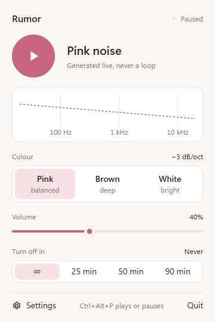
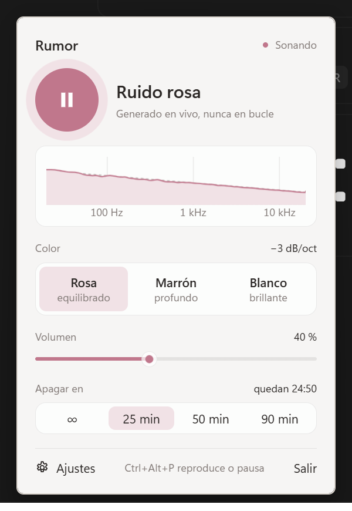
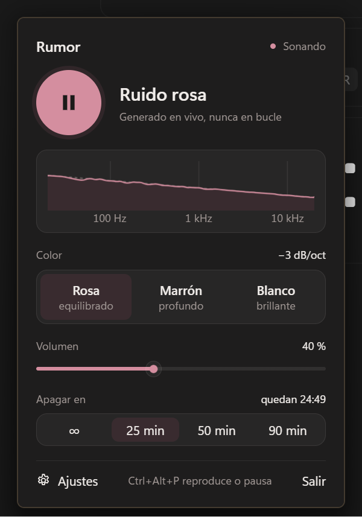
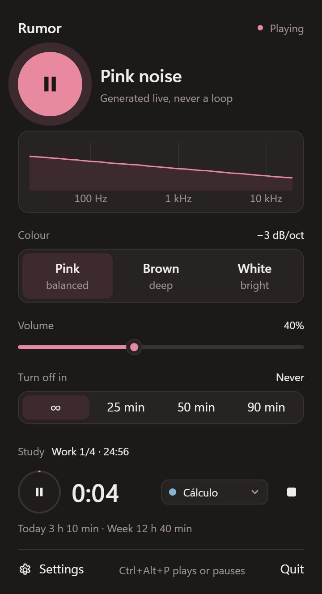

<p align="center">
  
</p>

<h1 align="center">Rumor</h1>

<p align="center"><b>Real-time pink, brown and white noise for the Windows tray.</b><br>
No loops, no compression, no account, no telemetry.</p>

<p align="center">
  
</p>

<p align="center">
  <a href="https://github.com/YusteMa/rumor/releases"><b>Download for Windows</b></a> · <a href="#en-español">Leer en español</a>
</p>

## Why

The pink noise on YouTube or Spotify is compressed audio. Noise is pure randomness and can't be compressed, so the codec mangles it (it sounds bubbly or metallic). It is also usually a loop that your brain eventually learns to hear.

Rumor **computes the noise sample by sample** on your PC, the way the iPhone's Background Sounds do. It never repeats and nothing is thrown away. It lives in the tray, one click or one shortcut away.

- **Three colours:** pink (balanced), brown (deep) and white (bright), each level-matched so switching never jumps in volume.
- **Headphones-aware:** if your headphones disconnect, Rumor pauses instead of playing through the speakers. It also pauses when you lock the PC.
- **Smooth everything:** fades on play, pause and every change. Not a single click.
- **Sleep timer** with a fade-out, **global shortcuts** (`Ctrl+Alt+P` plays or pauses, every other action can get its own), light and dark themes, Spanish and English.
- **Study mode (optional):** a stopwatch or Pomodoro that follows the noise, with a synthesized singing-bowl chime, tags, daily and weekly totals and a Statistics window. An optional floating mini clock keeps the time in view. `Ctrl+Alt+T` starts or pauses it.
- **Updates itself** with one click when a new version is out.
- **Zero telemetry.** Rumor sends nothing of yours; its only request is the update check on GitHub, which you can turn off in Settings → About.

<p align="center">
  
  
  
</p>

## Install

Windows 10 or 11, 64-bit.

1. Download **`Rumor_…_x64-setup.exe`** from the [latest release](https://github.com/YusteMa/rumor/releases).
2. Run it. Rumor appears in the tray (it may be hidden under the **^** arrow; drag it onto the taskbar to keep it in view).
3. **Left click** plays or pauses. **Right click** opens the panel.

**"Windows protected your PC"?** The beta isn't code-signed yet, so SmartScreen warns about any new app. Click **More info → Run anyway**. Code signing is planned for v1.0. If you prefer, you can [build it yourself](#build-from-source).

The `.msi` in the release is the same app, for managed installs.

## Feedback

This is a **beta**. Bug reports are very welcome, especially about sound, headphones and Bluetooth: [open an issue](https://github.com/YusteMa/rumor/issues/new/choose). Ideas and questions go to [Discussions](https://github.com/YusteMa/rumor/discussions). English or Spanish.

## Build from source

You need [Rust](https://rustup.rs) (MSVC toolchain), Node.js LTS and the Visual Studio Build Tools with the "Desktop development with C++" workload.

```bash
npm install
npm run tauri dev      # development
npm run tauri build    # installers in src-tauri/target/release/bundle/
```

Tauri v2, a Rust audio engine (`cpal`, WASAPI) and a small TypeScript panel without a UI framework. [SPEC.md](SPEC.md) describes the product, [ROADMAP.md](ROADMAP.md) what comes next and [CONTRIBUTING.md](CONTRIBUTING.md) how to help.

## En español

**Rumor** genera ruido rosa, marrón y blanco **en tiempo real** desde la bandeja de Windows. El ruido de YouTube o Spotify es audio comprimido: el códec lo destroza (suena burbujeante o metálico) y suele ser un bucle que el cerebro acaba notando. Rumor lo calcula muestra a muestra en tu PC, como los Sonidos de fondo del iPhone. Nunca se repite.

- Tres colores igualados en volumen, fundidos suaves y ni un clic.
- **Si se desconectan los cascos, se pausa**: nunca suena por los altavoces sin que lo pidas. También se pausa al bloquear el PC.
- Temporizador con fundido, atajos globales (`Ctrl+Alt+P` reproduce o pausa), tema claro y oscuro, en español e inglés.
- **Modo estudio** opcional: cronómetro o Pomodoro vinculado al ruido, con un cuenco tibetano sintetizado como aviso, etiquetas, totales de hoy y de la semana y una ventana de Estadísticas. Un mini reloj flotante opcional deja el tiempo a la vista. `Ctrl+Alt+T` lo inicia o lo pausa.
- **Se actualiza sola** con un clic cuando sale una versión nueva.
- **Sin telemetría:** Rumor no envía nada tuyo. Solo consulta GitHub para buscar actualizaciones, y se puede desactivar en Ajustes → Acerca de.

**Instalación** (Windows 10 u 11, 64 bits): descarga `Rumor_…_x64-setup.exe` de la [última versión](https://github.com/YusteMa/rumor/releases) y ábrelo. Rumor aparece en la bandeja (puede quedar oculto bajo la flecha **^**; arrástralo a la barra para tenerlo a la vista). Si Windows dice **«Windows protegió su PC»**, es porque la beta aún no está firmada: pulsa **Más información → Ejecutar de todas formas**. Clic izquierdo en el icono reproduce o pausa; clic derecho abre el panel.

Es una **beta**: los fallos (sobre todo de sonido, cascos y Bluetooth) van a [Issues](https://github.com/YusteMa/rumor/issues/new/choose) y las ideas y preguntas a [Discussions](https://github.com/YusteMa/rumor/discussions).

## License

[MIT](LICENSE)
